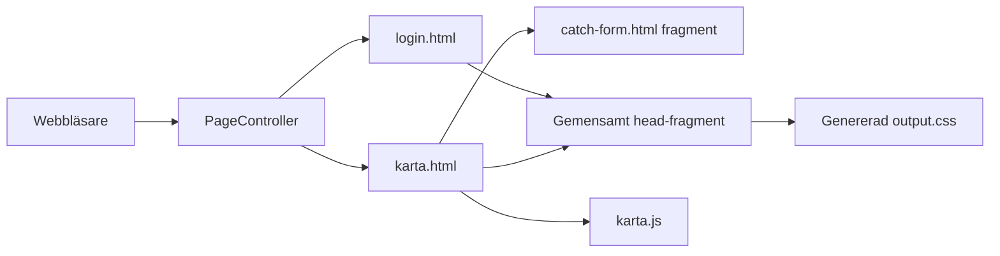

# Omfattning

### Mål
Återskapa Lovables responsiva inloggnings- och kartdesign med Thymeleaf, med fångstformuläret som en sidopanel. Använd `index.tsx` som förlaga för inloggningen, `karta (1).tsx` för kartan och formuläret samt `__root.tsx` för gemensamma dokumentresurser.

### Avgränsning
- Visa en tydligt märkt demonstration: Lovable har hårdkodade fångster, en illustrerad SVG-karta och inloggningen navigerar bara vidare. Projektet har ännu inga controllers, fångstmodeller eller autentiseringslösningar.
- Ingen faktisk registrering, inloggning, utloggning, bildlagring, AI-identifiering, GPS-avläsning eller sparning av fångster ingår. Behåll knappen **Logga in** och Lovables utseende, men ange tydligt att sidan är en demonstration och att autentisering inte sker. Klicket går direkt till `/karta` även med tomma fält och utan att skicka e-post eller lösenord; övriga ej implementerade åtgärder visas som otillgängliga.
- Behåll skissens interaktiva visning: välj en markör eller ett kort, stäng informationsrutan och öppna eller stäng formulärpanelen. Sökfältet är visuellt, precis som i förlagan.

# Teknisk design

### Befintligt läge
- `src/main/resources/templates/catch-form.html` är tom: filen kan återanvändas som plats för fragmentet, men har inget befintligt formulärinnehåll att bevara.
- `FiskeexpertenApplication.java` är den enda applikationsklassen. `pom.xml` innehåller Thymeleaf, layout-dialect, Spring Security och ett Tailwind Maven-plugin; det finns inga befintliga sidmallar eller controllers att följa.
- Det finns ingen egen säkerhetskonfiguration: Spring Securitys standardregler kräver autentisering även för `/` och `/karta`. Detta är kontrollerat genom kod och konfiguration, inte genom ett körningstest; dessutom saknas sidornas controllers och mallar ännu.
- `__root.tsx` delar dokumentstruktur, metadata, typsnitt och CSS, men inte kartans navigationsheader. React-router, QueryClient och Lovables felrapportering behöver inte överföras.

### Mallar och flöde
- **Ny `src/main/resources/templates/fragments/layout.html`:** gemensamt Thymeleaf-fragment för `<head>` med UTF-8, viewport, svenska som dokumentspråk, favicon, Fraunces/Manrope, `/css/output.css` och parametrar för sidans titel och beskrivning. Behåll sidspecifika Open Graph-metadata där de behövs.
- **Ny `src/main/resources/templates/login.html`:** Lovables tvåkolumnslayout med våg-SVG, varumärke, inmatningsfält och responsivt inloggningskort. Behåll texten **Logga in** och knappens utseende, men använd en länk stylad som knappen med `th:href="@{/karta}"`, utan formulärinsändning eller validering. Klicket fungerar även med tomma fält och skickar inga fältvärden vare sig i URL eller förfrågan. Visa separat att detta är en demonstration utan autentisering; kontoskapande är otillgängligt.
- **Ny `src/main/resources/templates/karta.html`:** header, illustrerad karta, markörer, informationsruta, fångstkort, sökfält och knapp för ny fångst. Rendera fyra tydligt märkta demonstrationsfångster via en enkel modell och `th:each`, så markörer och kort använder samma data; använd statiska, fullständiga Tailwind-klasser för gradientvarianter.
- **Befintlig `src/main/resources/templates/catch-form.html`:** bygg upp ett `th:fragment` för panelens formulär och inkludera det i `karta.html` med `th:replace`. Behåll Lovables fält och uppladdnings-/AI-/positionsytor visuellt, men markera ej implementerade åtgärder som otillgängliga; lägg till korrekta etiketter och knapparnas typer.
- **Ny `src/main/resources/static/js/karta.js`:** hantera vald fångst, stängning av popup samt öppning och stängning av panelen utan React. Gör kort och markörer tangentbordsanvändbara, hantera Escape, fokus och klick på bakgrunden.
- **Nya `PageController` och `DemoCatch` under `src/main/java/org/example/fiskeexperten/`:** GET `/` renderar `login`, GET `/karta` renderar `karta` med demonstrationsdata. Behåll all data lokal och tillfällig; ingen databas eller API-integration.
- **Ny `src/main/java/org/example/fiskeexperten/SecurityConfig.java`:** eftersom standardreglerna skyddar sidorna, inför en `SecurityFilterChain` som endast tillåter anonyma GET-anrop till `/`, `/karta` och nödvändiga statiska resurser, exempelvis `/css/**`, `/js/**` och favicon. Kräv autentisering för övriga anrop och behåll CSRF-skyddet samt standardinloggning och HTTP Basic för skyddade resurser. Säkerhetsändringen beskrivs för användaren innan den görs; den innebär ingen faktisk inloggning via demonstrationsknappen.
- Använd inline-SVG eller lokala ikoner för Lovables Lucide-symboler och undvik att införa React.

### Tailwind och CSS
- Lovables `styles.css` är en Tailwind v4-källfil med semantiska OKLCH-färger, radier, Fraunces/Manrope, `shadow-soft` och `bg-dawn`. Projektets `input.css` har bara Tailwind-importen och en `@source`; `output.css` är genererad Tailwind v4.3.5 med grundstilar och nästan inga nyttoklasser. Det finns alltså inga motsvarande projektspecifika designtokens att återanvända.
- Lägg i `../../src/main/resources/static/css/input.css` till Lovables ljusa tokens och `@theme inline`-kopplingar för de färger, radier och den skugga som mallarna använder, samt grundstilar för bakgrund, text och typsnitt och `@utility bg-dawn`. Undvik självrefererande typsnittsvariabler och bevara färgvärdena från förlagan.
- Korrigera källskanningen: nuvarande `@source "../resources/templates"` är relativ till `input.css` och pekar inte på mallkatalogen. Använd explicit källskanning av mallarna, inklusive fragmenten, och håll dynamiska klassnamn borta så nödvändiga responsiva klasser och opacitetsvarianter genereras.
- Fortsätt bygga `src/main/resources/static/css/output.css` med Maven-pluginet i `pom.xml`; redigera inte den genererade filen för hand. `tailwind.config.js` har tom `extend` och Tailwind v4 läser inte in den automatiskt: lägg designen i CSS-källan i stället för att anta att konfigurationen används.
- Kopiera inte `tw-animate-css`, Lovables mörkvariant eller diagram-/sidopaneltokens som inte används av dessa sidor. Lovables fil definierar inte heller några mörka färgvärden.

# Verifiering

### Kontroller vid senare genomförande
- Bygg Tailwind via projektets Maven-flöde och kontrollera att `output.css` innehåller de nya semantiska färgerna, gradienten, skuggan och mallarnas responsiva klasser.
- Lägg till riktade MVC-/säkerhets- och malltester för anonyma GET `/` och `/karta` samt nödvändiga statiska resurser. Kontrollera också att andra skyddade anrop fortfarande kräver autentisering och att CSRF-skyddet finns kvar; verifiera titel, gemensamt head-fragment, fångstlistan och det inkluderade formuläret. Behåll befintliga `FiskeexpertenApplicationTests` och kör lämpliga tester med Maven när projektets Java- och databasförutsättningar finns.
- Kontrollera i webbläsare att **Logga in** med tomma respektive ifyllda fält navigerar till `/karta` utan valideringshinder och att nätverksförfrågan och URL:en inte innehåller e-post eller lösenord. Kontrollera även smal och bred vy, markör- och kortval, popup, panel, Escape/fokus samt att otillgängliga funktioner inte påstår att något sparats.

# Delivery Steps

### ✓ Step 1: Lägg grund för gemensam design och sidvisning
Gemensamma resurser och demonstrationssidornas serverflöde är på plats.

- Kontrollera först de aktuella säkerhetsreglerna och förklara för användaren varför en begränsad ändring behövs innan den genomförs.
- Lägg till head-fragment, `PageController`, demonstrationsmodell och `SecurityConfig` med anonym GET-åtkomst endast till de avsedda sidorna och resurserna.
- För över relevanta Lovable-tokens till `input.css`, rätta källskanningen och generera Tailwind-CSS med Maven.
- Kontrollera anonym åtkomst, skydd för övriga anrop och att grundläggande färg-, typsnitts- och responsiva klasser genereras.

### ! Step 2: Återskapa inloggningssidan
Inloggningsdesignen visas responsivt utan att ge sken av fungerande autentisering.

- Skapa `login.html` med Lovables varumärke, vågor och inloggningskort och använd det gemensamma head-fragmentet.
- Behåll texten **Logga in** och Lovables knapputseende; låt knappen navigera direkt till `/karta` utan formulärinsändning eller validering, även när fälten är tomma.
- Märk sidan som en demonstration utan autentisering och markera otillgängliga kontoåtgärder.
- Verifiera sidans metadata och responsiva layout samt att klick med tomma och ifyllda fält inte skickar e-post eller lösenord i URL eller förfrågan.

### ! Step 3: Återskapa kartan och fångstlistan
Kartsidan visar och väljer samma demonstrationsfångster i markörer och kort.

- Skapa `karta.html` med Lovables header, SVG-karta, popup, sökfält och responsiva fångstkort.
- Rendera demonstrationsdata med Thymeleaf och implementera markör-, kort- och popupinteraktioner i `karta.js`.
- Testa modellrendering, markeringsval och tangentbordsanvändning.

### ! Step 4: Integrera den återanvändbara fångstpanelen
Den befintliga `catch-form.html` innehåller ett fragment som öppnas som sidopanel på kartan.

- Bygg upp formulärfragmentet med Lovables fält och utseende och inkludera det i `karta.html`.
- Implementera öppning, stängning, Escape, bakgrundsklick och fokushantering i `karta.js`.
- Markera bildhantering, AI, position och sparning som otillgängliga och verifiera panelens funktion i smal och bred vy.
